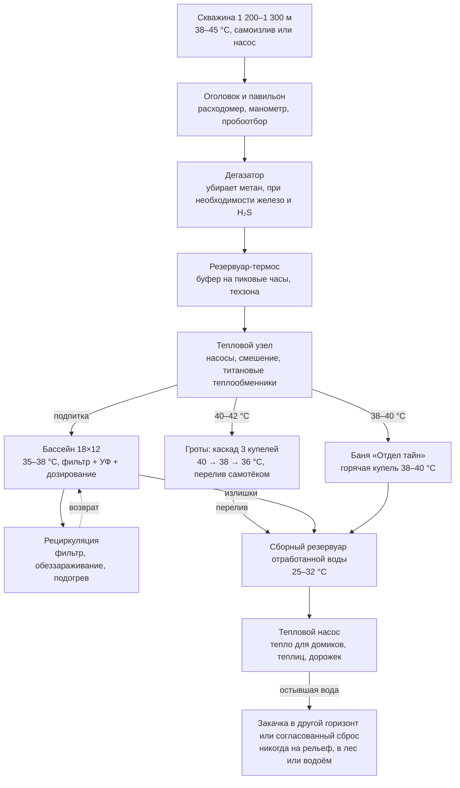

# Тёплая деревня — как пустить термальную воду по территории и гротам

Снимок страницы от 18.11.2026: [Инженерная схема термальной воды и гротов](https://cursor.com/canvas/store-c0a907db-1105-4a2e-a16a-5c91f22bdc35/0aaebea8-089e-4eca-84f3-b2b2e040dcd9).

Принципиальная инженерная схема: от скважины до гротов, бассейна, бани и сброса, кто какую воду получает, как строить гроты под тюменскую зиму, материалы, ориентировочная смета и пожарная защита деревянных домов. Это концепция для разговора с гидрогеологом и проектировщиком, а не рабочий проект.

**Содержание**

1. [Главное](#1-главное)
2. [Схема движения воды](#2-схема-движения-воды)
3. [Каскад гротов в разрезе](#3-каскад-гротов-в-разрезе)
4. [Кому какая вода](#4-кому-какая-вода)
5. [Как построить гроты и ландшафт](#5-как-построить-гроты-и-ландшафт)
6. [Материалы](#6-материалы)
7. [Ориентировочная смета](#7-ориентировочная-смета)
8. [Куда девать отработанную воду](#8-куда-девать-отработанную-воду)
9. [Пожарная защита](#9-пожарная-защита)
10. [Что требует изысканий и разрешений](#10-что-требует-изысканий-и-разрешений)
11. [Следующие шаги](#11-следующие-шаги)
12. [Источники](#12-источники)

## 1. Главное

> **Тюменская термальная вода выходит из скважины уже тёплой, 38–45 °C, но она солёная и с газом.**
>
> Поэтому её не нужно охлаждать для купелей, но нельзя пускать в краны домиков и сливать на землю. Схема строится так: скважина → дегазация → резервуар-термос → потребители каскадом от самой горячей воды к прохладной → забор остатка тепла → закачка обратно в недра или согласованный сброс.

- Местные примеры: «Верхний Бор» — скважина 1 233 м, вода на выходе около +45 °C; «Аван» — 1 200 м и +42 °C; скважина у санатория Оловянникова — 1 282 м.
- Состав типичный для юга области: хлоридно-натриевая вода с минерализацией 6–20 г/л, йодом и бромом, растворённый газ азотно-метановый.
- В бизнес-плане скважина, лицензия и сброс не посчитаны: CAPEX 56,89 млн ₽ первой очереди идёт «без земли и новой скважины».
- Бассейн 18×12 стоит в первой очереди, поэтому скважина и тепловой узел нужны сразу, а не в четвёртой очереди вместе с техзоной, как сейчас в генплане.
- Все гостевые дома, баня, ресторан и ферма задуманы деревянными. Одними огнетушителями загоревшийся дом не потушить — в проект закладывается полная пожарная защита, см. [раздел 9](#9-пожарная-защита).

## 2. Схема движения воды



1. **Добыча.** Скважина вскрывает апт-альб-сеноманский горизонт. На юге области вода часто идёт самоизливом с напором 20–40 м выше земли, тогда насос нужен лишь для регулировки. Всё оборудование в контакте с водой — из нержавейки, титана или пластика.
2. **Дегазация и подготовка.** Газ в этой воде азотно-метановый, поэтому сразу после скважины вода проходит дегазатор с вентиляцией и газоанализатором. Нужна ли обезжелезка и удаление сероводорода, покажет лабораторный анализ.
3. **Буфер.** Утеплённый резервуар-термос накапливает воду ночью и отдаёт днём, когда в купелях больше гостей. Объём считает технолог по дебиту и графику посещений.
4. **Распределение.** От теплового узла по территории идут предизолированные пластиковые трубы под землёй. Каждый объект получает свою ветку с отдельным учётом расхода и отсекающими кранами.
5. **Каскад и рециркуляция.** В гротах вода переливается из верхней купели в нижние самотёком. В бассейне — замкнутый контур фильтрации и обеззараживания, а термальная вода идёт как подпитка и источник тепла.
6. **Вторая жизнь тепла.** Отработанная вода ещё тёплая. Тепловой насос забирает это тепло для тёплых полов домиков, теплиц фермы и снеготаяния дорожек.
7. **Отвод.** Солёную воду нельзя лить на рельеф: под Тюменью это уже приводило к засолению почв и озёр. Варианты — закачка в другой глубокий горизонт или сброс в канализацию по договору с водоканалом при малых объёмах.

## 3. Каскад гротов в разрезе

Принципиальный разрез, высоты и температуры — оценка для обсуждения.

```text
                         свод грота
                      .--‾‾‾‾‾‾‾--.
                     /             \
                    |  Купель 1     |  40–41 °C
холм из грунта      |  перепад      |
котлована           |  0,4–0,6 м    |
                    |  Купель 2     |  38–39 °C
                    |       ↓       |
                    |  Купель 3     |  36–37 °C
                    |       ↓ лоток |
────────────────────┴───────────────┴────────────
подача 40–42 °C из термоса              самотёком
снизу в верхнюю купель            в сборный резервуар
```

Участки под Тюменью обычно ровные, поэтому самотёчный каскад делают на искусственном холме высотой 2,5–3,5 м из грунта котлована бассейна и гротов (оценка). Верхняя купель получает свежую воду снизу через донные форсунки, нижние — перелив из верхней, а лоток последней купели уводит воду самотёком в сборный резервуар. Самотёчные трубы кладут с уклоном около 1–2 % (оценка, уточняет проектировщик ВК).

## 4. Кому какая вода

Номера зон — по генплану из бизнес-плана от 16.11.2026.

| Объект | Очередь | Что получает | Температура |
| --- | --- | --- | --- |
| 4 · Бассейн 18×12, 259–292 м³ | 1 | Подпитка термальной водой, тепло через теплообменник, рециркуляция с фильтрацией | 35–38 °C (оценка) |
| 2–3 · Гриффиндор, Слизерин | 1 | Только тепло от теплового насоса в тёплые полы; в краны — обычная питьевая вода | полы 30–35 °C |
| 15 · Гроты и купели, 3 чаши 54 м² | 4 | Прямая термальная вода каскадом, проточно или с рециркуляцией | 40 → 38 → 36 °C |
| 17 · Баня «Отдел тайн» | 4 | Горячая купель на термальной воде; холодная купель — на питьевой | 38–40 °C и 10–15 °C |
| 11–14 · Хижина, Когтевран, Пуффендуй, Дом звёзд | 3 | Тепло в полы; по желанию чан на террасе с термальной водой | чан 38–40 °C |
| 16 · Ферма и теплицы | 4 | Тепло отработанной воды через тепловой насос: тёплые грядки и полы | 25–40 °C |
| 5–10 · Ресторан, пекарня, дома | 2 | Только питьевая вода; тепло — по желанию от общего контура | — |
| Дорожки между домиками, баней и гротами | 1–4 | Снеготаяние от контура отработанной воды или греющий кабель | +3…+5 °C на поверхности |

Солёную воду 6–20 г/л не пускают в души и краны домиков: она оставляет соль на сантехнике и разъедает металл. Для питья, кухни и душей нужна отдельная скважина на пресную воду или сеть.

## 5. Как построить гроты и ландшафт

### Конструкция грота

1. **Основание и чаши.** Монолитная железобетонная плита и чаши из водонепроницаемого морозостойкого бетона. Против солёной воды — увеличенный защитный слой арматуры или композитная арматура.
2. **Гидроизоляция.** Проникающая плюс обмазочная полимерцементная, в чашах — ПВХ-мембрана или облицовка, стойкая к минеральной воде.
3. **Свод и скалы.** Каркас из оцинкованной или нержавеющей стали, сетка, торкрет и художественный слой архитектурного бетона, который скульпторы лепят вручную и тонируют.
4. **Скрытые коммуникации.** Трубы, подсветку и форсунки закладывают в тело скалы до финишного слоя, со смотровыми люками.
5. **Безопасность.** Противоскользящие ступени и борта, поручни, подсветка 12 В в воде, УЗО, глубина купели не более 1–1,2 м (оценка).
6. **Пар и вентиляция.** Открытый или полуоткрытый грот проветривается сам. Закрытый грот проектируют как крытый бассейн: приточно-вытяжная вентиляция с осушением и газоанализатор.

### Ландшафт

- Гроты встраиваются в насыпной холм: сверху — сосны и кустарники, внутри — купели, снаружи — тропа квеста.
- Натуральные валуны и галька только по краям и на тропах; основной рельеф — из арт-бетона, он легче и дешевле.
- Тёмные, тёплые оттенки скал: йод, бром и железо оставляют рыжеватый налёт, на тёмном он незаметен.
- Деревья не ближе нескольких метров к купелям: солёные брызги и пар вредят хвое (расстояние уточняет дендролог).
- Вырубку леса по эскизному генплану бизнес-план прямо запрещает — посадку гротов делают после топосъёмки.

### Зима: −35 °C

- Вход в воду из тёплого помещения или через тёплый переход, как на тюменских термах, а не по улице.
- Над водой в мороз поднимается густой пар: это эффект, но он оседает инеем на поручнях, ветках и сводах — поручни с подогревом, своды с уклоном для стока.
- Дорожки, ступени и пятачки у воды — с подогревом и водоотводом, иначе каток.
- Все трубы — под землёй ниже глубины промерзания (для Тюмени порядка 1,5–2 м, уточняет геология) или в предизолированных трубах с греющим кабелем.
- Резервный генератор и аварийное опорожнение линий: без насосов трубы в мороз замерзают за часы.
- Чаши не опорожняют зимой: тёплая проточная вода сама защищает их от льда.

## 6. Материалы

Цены — розничные ориентиры из открытых прайсов на 2025–2026 годы, без доставки до Тюмени.

| Узел | Материал | Ориентир цены |
| --- | --- | --- |
| Скважина | Обсадка и насос из нержавеющей стали | 17 900–29 900 ₽ за метр бурения (geol.ru) |
| Магистрали | Предизолированная гибкая труба PE-Xa в ППУ, 95 °C | 4 646 ₽/м (63/110), 7 811 ₽/м (90/140), tk-isk.ru |
| Внутри узла | Трубы PP, PVC-U или PE-RT; не чёрный металл и не оцинковка | по КП |
| Теплообмен | Пластинчатый теплообменник с титановыми пластинами | от 232 213 ₽ за 140 кВт, 622 652 ₽ за 446 кВт (bas.ru) |
| Фильтрация | Песчаный фильтр и насос для общественного бассейна | фильтр 30 м³/ч — 54 017 ₽, 100 м³/ч — 527 741 ₽ (hydropartner.ru); насос 30 м³/ч — 32–39 тыс. ₽ |
| Тепло отработанной воды | Тепловой насос вода-вода 100 кВт | 1 280 000 ₽ (solar-dom.com); винтовой от 2 643 302 ₽ (sundue.ru) |
| Скалы грота | Архитектурный бетон по каркасу | от 6 700 ₽/м² (artgeo-studio.ru), от 16 000 ₽/м² (skabek.ru) |
| Облицовка стен | Плитка искусственного камня «Скалистый грот», F500 | 2 040–2 318 ₽/м² (loft-kirpich.ru, kamrock.com) |
| Гидроизоляция чаш | ПВХ-мембрана для бассейнов | 1 500–3 400 ₽/м², монтаж по КП |
| Тёплые дорожки | Греющий кабель с автоматикой | 3 000–7 500 ₽/м² под ключ (ytek.pro) |
| Натуральный камень, настилы | Валуны, противоскользящий камень, термодревесина | оценка, нужны местные КП |

## 7. Ориентировочная смета

Млн ₽, только то, чего нет в бизнес-плане. На исходной странице сценарий переключается: новая скважина или готовая, и способ отвода (канализация / река / закачка в пласт). Ниже — все шесть сочетаний и расшифровка статей.

Уже заложено в бизнес-плане: **58,0 млн ₽** (бассейн 39,40 + гроты 13,00 + купели бани 5,60).

Ориентир водной инженерии сверх бизнес-плана по сценариям (без НДС-эффектов и доставки):

| Скважина | Отвод | Сверх бизнес-плана, млн ₽ |
| --- | --- | --- |
| Новая скважина | Канализация | 39,9–88,4 |
| Новая скважина | Река | 41,9–95,4 |
| Новая скважина | Закачка в пласт | 49,9–118,4 |
| Участок с готовой скважиной | Канализация | 21,4–57,5 |
| Участок с готовой скважиной | Река | 23,4–64,5 |
| Участок с готовой скважиной | Закачка в пласт | 31,4–87,5 |

Разброс по всем шести сценариям — примерно от 21 до 117 млн ₽. Больше всего решают две вещи: найти участок с готовой законсервированной скважиной (экономит 15–35 млн ₽) и объём отработанной воды: при рециркуляции её мало и хватает канализации, при проточном режиме нужна река или поглощающая скважина.

| Статья | Новая скважина, млн ₽ | Готовая скважина, млн ₽ | Тип | На чём основано |
| --- | --- | --- | --- | --- |
| Изыскания, лицензия, оценка запасов, проекты ВК/ОВ/технологии воды | 2,0–5,0 | 2,0–5,0 | Смешанно | Госпошлина за лицензию 7 500 ₽, оценка запасов с экспертизой от 250–300 тыс. ₽; остальное — оценка |
| Бурение добычной скважины 1 200–1 300 м / восстановление готовой (законсервированной) скважины | 21,5–38,9 | 3,0–8,0 | Источник / оценка | 17 900–29 900 ₽/м (geol.ru, скважины глубже 600–1000 м); для готовой скважины — оценка |
| Обустройство скважины: насос из нержавейки, оголовок, павильон, дегазатор | 3,0–6,0 | 3,0–6,0 | Оценка | Оценка, нужно КП |
| Резервуар-термос, насосная станция, автоматика | 2,0–4,0 | 2,0–4,0 | Оценка | Оценка, нужно КП |
| Магистрали по территории, около 500 м предизолированных труб | 3,5–6,0 | 3,5–6,0 | Источник + оценка | Изопрофлекс 63/110 — 4 646 ₽/м, 90/140 — 7 811 ₽/м (tk-isk.ru, 2025) + фитинги и траншеи (оценка) |
| Утилизация тепла: тепловой насос вода-вода, титановые теплообменники | 3,0–6,0 | 3,0–6,0 | Источник + оценка | ТН 100 кВт — 1,28 млн ₽ (solar-dom.com), винтовой — от 2,64 млн ₽ (sundue.ru); титановый ТО 140 кВт — 232 тыс. ₽ (bas.ru); монтаж — оценка |
| Отвод: канализация и локальная очистка (малые объёмы) | 1,0–3,0 | 1,0–3,0 | Оценка | Оценка; возможно только при согласовании с водоканалом |
| Отвод: сброс в реку по решению о водопользовании (выпуск, пруд-охладитель, НДС, мониторинг) | 3,0–10,0 | 3,0–10,0 | Оценка | Оценка; реально только у крупной реки, плюс ежегодные анализы и плата за НВОС |
| Отвод: поглощающая скважина в другой горизонт | 11,0–33,0 | 11,0–33,0 | Источник + оценка | 10–30 млн ₽ за скважину + изыскания 1–3 млн ₽ (vaco-eng.ru); глубина — после гидрогеологии |
| Тёплые дорожки, 300–500 м² ключевых маршрутов | 0,9–3,8 | 0,9–3,8 | Источник + оценка | 3 000–7 500 ₽/м² под ключ (ytek.pro); площадь — оценка |
| Ландшафт: проект на 2 га, насыпной холм, дренаж, озеленение | 3,0–10,0 | 3,0–10,0 | Источник + оценка | Проект 5 000–25 000 ₽ за сотку (artgeo-studio.ru); земляные работы и посадки — оценка |
| Доплата к декору гротов (в бизнес-плане 1,70 млн ₽) | 0,0–4,7 | 0,0–4,7 | Источник + оценка | Арт-скалы 6 700–16 000 ₽/м² (artgeo-studio.ru, skabek.ru) × 200–400 м² (оценка) минус 1,70 млн ₽ |

В каждом сценарии в сумму входит только один вариант отвода.

## 8. Куда девать отработанную воду

> **В реку сливать можно, но только по решению о предоставлении водного объекта в пользование и в пределах норматива допустимого сброса.**
>
> Соль из воды дёшево не убрать, поэтому для солёной воды 6–20 г/л это реально только у большой реки вроде Туры, Пышмы или Тобола. Главное решение — не гонять воду протоком, а очищать и гонять по кругу: тогда отработанной воды в десятки раз меньше и её можно сдать в канализацию.

### Как делают в Тюмени

- **«Аван», с. Каменка** (водоём). Сброс в болото без названия по решению о предоставлении водного объекта в пользование. Жители связывают со сбросом засохший лес, директор базы — с подтоплением низины (72.ru, 2021).
- **Вся область** (реки). По данным Росприроднадзора, среди загрязняющих веществ в сбросах в водоёмы области преобладают хлориды и сульфаты — именно со сбросами термальных и минеральных вод. Так что сброс в водоёмы — реальная практика, и надзор её считает.
- **Река Тура** (река). Исследование ТюмГУ (2017) фиксирует зону загрязнения хлоридами в месте впадения минерального ручья со стоком минерализованных подземных вод.
- **«Тараскуль»** (озеро). Пробурена поглощающая скважина в уватскую свиту, но закачка не ведётся; в 2014 году заказана оценка воздействия утилизации минеральных вод в озеро Малый Тараскуль.
- **Тюменская ТЭЦ-2** (закачка). Около 10 лет закачивает минерализованные стоки в глубокий горизонт, 30–60 м³ в сутки — местный пример закачки.
- **«Верхний Бор»** (рециркуляция). Открыто сообщает о системе очистки и обеззараживания минеральной воды в бассейнах. Куда идёт отработанная вода, в открытых источниках не сказано.

### Почему главная проблема — соль

| Показатель | Значение |
| --- | --- |
| Хлориды в нашей воде при 6–20 г/л, в основном NaCl (оценка) | 3 600–12 000 мг/л |
| Норма для рыбохозяйственных водоёмов, хлориды (приказ Росрыболовства № 296, с 01.09.2025) | 300 мг/л |
| Норма для рыбохозяйственных водоёмов, сульфаты | 100 мг/л |
| Предел хлоридов для сброса в канализацию (Тюмень, Правила № 644) | 1 000 мг/л |
| Во сколько раз вода соленее речной нормы | 12–40 раз |
| Во сколько раз вода соленее нормы для канализации | 4–12 раз |

Разбавить чистой водой не поможет: норматив допустимого сброса считают в килограммах соли, а не только в концентрации, и соблюдать норму нужно в реке ниже выпуска. Речка или ручей не разбавят такой сток, большая река — может быть.

### Сколько воды придётся сбрасывать

| Режим | Оценка объёма |
| --- | --- |
| Проточный режим, 5–10 л/с | 430–860 м³/сут |
| Рециркуляция с фильтрами (предпочтительный вариант) | 15–50 м³/сут |

Оценка. При рециркуляции сбрасывают только подпитку (по СП 2.1.3678-20 не менее 50 л свежей воды на посетителя в сутки) и промывку фильтров. Это как раз тот объём, при котором учёный ТИУ считает возможным сброс в канализацию вместе с бытовыми стоками.

### Варианты и честная оценка

| Вариант | Затраты | Вердикт |
| --- | --- | --- |
| Рециркуляция вместо протока: фильтрация и обеззараживание без потери минерализации | Уже в бизнес-плане: фильтры и насосы бассейна 5,50 млн ₽, дезинфекция 2,00 млн ₽ | Делать обязательно |
| Канализация вместе с бытовыми стоками по договору с водоканалом | 1–3 млн ₽ (оценка), если сеть рядом; плата за превышение состава — по правилам водоканала | Лучший при малом объёме |
| Накопитель и вывоз цистерной на очистные по договору | Ёмкость — оценка; вывоз — по тарифу перевозчика и приёмщика | Временно, на старте |
| Сброс в реку или озеро по решению о водопользовании | 3–10 млн ₽ (оценка) + ежегодные анализы, отчёты и плата за негативное воздействие | Только у крупной реки |
| Закачка в поглощающую скважину | 10–30 млн ₽ за скважину, изыскания 1–3 млн ₽, эксплуатация 200–500 ₽/м³ (vaco-eng.ru) | Самый чистый, для больших объёмов |
| Обратный осмос (опреснение) | Установка 10 м³/ч — от 22 010 у.е. (aquapd.ru); при 7–15 г/л 25–35 % воды уходит в рассол (vaco-eng.ru) | Не решает: рассол всё равно куда-то девать |
| Пруды-испарители | Нужно 1–2,5 м испарения в год, в Тюмени 300–450 мм и лёд полгода: на 20 м³/сут нужно 1,6–2,4 га (расчёт) | Не подходит |
| Биоплато, искусственное болото, полив | Соль не удаляют, соль убивает растения и засоляет почву | Не подходит |
| Тепло и рыборазведение | Тепловой насос уже в смете; рыбхозы Пышма и Казанский работают на минерализованной воде (geum.ru) | Дополнение: потом всё равно сброс |

### Что нужно, чтобы законно сливать в реку

1. **Подходящая река.** Расход воды и фоновая солёность должны позволять уложиться в 300 мг/л хлоридов ниже выпуска. Все крупные реки области — рыбохозяйственные, нормы строгие.
2. **Решение о предоставлении водного объекта в пользование.** По ст. 11 и 22 Водного кодекса, до 20 лет. Заявление подают в территориальный орган Росводресурсов с расчётом объёма и состава сброса, поквартальным графиком и приборами учёта.
3. **Нормативы допустимого сброса.** Расчёт по Методике Минприроды № 1118. Надзор откажет, если сброс превышает нормативы допустимого воздействия на реку.
4. **Очистные сооружения.** Ст. 60 Водного кодекса запрещает сброс без обезвреживания и очистки: дегазация, обеззараживание, пруд-охладитель, чтобы тёплая вода не нагревала реку.
5. **Запретные зоны.** По ст. 44 в первом поясе санохраны питьевых источников и первой зоне округов лечебных ресурсов сброс запрещён, во втором и третьем поясах — дополнительные требования.
6. **Постоянный контроль.** Учёт объёма, анализы в аккредитованной лаборатории, отчёты и плата за негативное воздействие. Оформление — ориентировочно 6–12 месяцев (оценка).

### Что будет за сброс без разрешения

| Нарушение (КоАП, для юрлиц) | Штраф |
| --- | --- |
| Ст. 7.6 — сброс без решения о водопользовании | 50–100 тыс. ₽ или приостановка до 90 суток |
| Ст. 8.14 ч. 1 — нарушение правил водопользования при сбросе | 80–100 тыс. ₽ или приостановка до 90 суток |
| Ст. 8.13 ч. 4 — превышение нормативов | 150–300 тыс. ₽ |
| Возмещение вреда водному объекту | считается отдельно: с тюменской птицефабрики потребовали 89 млн ₽ |

ИП по КоАП обычно отвечает как юрлицо, если статья не говорит иное. Пример с птицефабрики — не про термы, он показывает порядок сумм за вред.

### Рекомендация

1. Сразу проектировать бассейн, гроты и купели на рециркуляции с очисткой, чтобы отработанной воды было около 15–50 м³ в сутки, а не сотни.
2. Перед сбросом забирать тепло тепловым насосом, охлаждать и отстаивать в закрытой ёмкости.
3. При выборе участка проверять, есть ли рядом канализация или очистные, и заранее запросить у водоканала, примет ли он минерализованную воду и на каких условиях.
4. Если канализации нет, а рядом большая река, — заказать предварительный расчёт НДС до покупки земли. Если ни того, ни другого — закладывать поглощающую скважину.
5. Никогда не сливать на рельеф, в лес, канаву или болото без решения: это штрафы, возмещение вреда и конфликт с соседями, как у «Авана».

## 9. Пожарная защита

Концепция для деревянной базы. Точные количества, диаметры труб и места на генплане считает проектировщик после выбора участка и эскиза зданий.

> **Огнетушителями нельзя потушить дом, который уже весь горит.**
>
> Огнетушитель нужен для первых секунд: загорелась штора, розетка, уголёк у печи. У типичного порошкового ОП-5 заряд кончается за 10–15 секунд. Полностью охваченный огнём деревянный дом тушат уже пожарные машины: по нормам это 10 литров воды каждую секунду в течение трёх часов. Поэтому в проект закладываем не только огнетушители «где положено», а всю систему: разрывы между домами, пропитку дерева, сигнализацию, подъезды для машин, запас пресной воды и правила для бань и мангалов.

Все гостевые дома, баня, ресторан и постройки фермы задуманы деревянными. Пока нет рабочего проекта, принимаем самую строгую оценку: степень огнестойкости V, класс конструктивной пожарной опасности C2–C3. Ниже — что это значит на практике.

### По каким нормам считаем

- Правила противопожарного режима в РФ — постановление Правительства № 1479, в редакции постановления № 90 от 03.02.2025 (действует с 01.09.2025). Огнетушители — раздел XIX и приложения 1–3.
- СП 4.13130 — разрывы между зданиями и подъезды пожарных машин (раздел 8).
- СП 8.13130.2020 с изменением (приказ МЧС № 1329 от 25.12.2023) — наружное противопожарное водоснабжение: расход, резервуары, гидранты, водоёмы.
- СП 10.13130 — внутренний противопожарный водопровод. При нынешних размерах домов и ресторана он, скорее всего, не потребуется, это проверит проектировщик.
- СП 486.1311500 и СП 484.1311500 — где нужна автоматическая пожарная сигнализация (АУПС) и как её проектировать.
- СП 3.13130 — система оповещения и управления эвакуацией (СОУЭ).
- СП 2.13130 и ГОСТ Р 53292 — огнезащита древесины, группы огнезащитной эффективности I и II.
- Молниезащита — по СО 153-34.21.122-2003 и РД 34.21.122-87. Бани, печи и мангалы — по ППР № 1479.

### Схема размещения

Принципиальная расстановка, не рабочий генплан. Когда появится участок, схему переносят на топосъёмку.

```text
Пожарный подъезд, ширина не меньше 3,5 м                    [разворот 15×15 м]
  ♦ гидрант        ♦ гидрант        ♦ гидрант        ♦ гидрант

[Гриффиндор 44 м²] --15 м-- [Слизерин 44 м²] --15 м-- [Когтевран ~40 м²] --15 м-- [Пуффендуй ~40 м²]   [Дом звёзд]  [Хижина 38 м²]
  •• ОП                       •• ОП                         •• ОП                       •• ОП                   •• ОП          •• ОП

[Ресторан «Три метлы» ~50 мест]   [Пекарня]   [Бассейн 18×12, раздевалки: 2 ОП]
  •• ОП  [шкаф]                     •• ОП

[Баня «Отдел тайн» 18×14 м, 252 м²]  [Гроты и купели, щит у настилов]  [Ферма, теплицы] --не ближе 30 м-- [Резервуар 100 м³] [Резервуар 100 м³]
  •••• ОП  [шкаф]                                                        •• ОП  [щит]                      площадка 12×12      площадка 12×12
```

Условные обозначения (схема принципиальная, не в масштабе генплана):

- **•• ОП / ОУ / ОВП** — огнетушитель
- **[шкаф] / [щит]** — пожарный шкаф или щит
- **♦** — гидрант
- **резервуар** — пожарный резервуар с пресной водой

Подъезд подходит к каждому зданию; от края дороги до стены 5–8 м. Тупик не длиннее 150 м. От забора воды из резервуара до деревянного дома — не меньше 30 м, площадка под машину 12×12 м. До фермы и складов разрыв до деревянных домов уточняет проектировщик, обычно 15–18 м. Деревянные дома — разрыв 15 м, у каждого входа огнетушители, вдоль дороги гидранты.

### Что поставить в каждом типе зданий

| Здание | Класс | Огнетушители | Что ещё обязательно |
| --- | --- | --- | --- |
| Гостевые дома «Гриффиндор», «Слизерин» и другие, 44 м², один этаж | Ф1.2, V, C2–C3 | Не меньше двух на этаж, ранг от 2A: два порошковых ОП-4 или ОП-5 (заряд ABCE). У электрощита — углекислотный ОУ-2 или ОУ-3. До огнетушителя не дальше 20 м | Разрыв 15 м до соседнего деревянного дома, огнезащита несущих и кровельных конструкций I группы, АУПС, звуковое оповещение, молниезащита, эвакуационный выход |
| Хижина Хагрида, 38 м², и «Дом звёзд» | Ф1.2, V, C2–C3 | Так же: два ОП-5 и ОУ у щитка | Те же разрыв, пропитка, сигнализация и молниезащита |
| Ресторан «Три метлы», ориентир 50 мест | Ф3.2, V, C2–C3 | Не меньше двух на этаж, ранг 2A и 55B. В зале — ОП-5. На кухне — порошковый или воздушно-пенный ОВП плюс противопожарное полотно (жир и масло — класс B). У щита — ОУ | АУПС, звуковое СОУЭ (речевое нужно, если зал 800 м² и больше — у нас меньше), огнезащита, разрыв 15 м, особое внимание кухне |
| Волшебная пекарня | Пищевое производство, печи | Два ОП-5 и ОУ, плюс средства у печей | АУПС, огнезащитные разделки дымоходов, негорючие разделы вокруг печей |
| Баня «Отдел тайн», 18×14 м, 252 м² | Ф3.6, V, C2–C3 | Из-за площади и правила «не дальше 20 м» ориентир 4–6 огнетушителей ОП-5, ОУ в электрощитовой, отдельные у помещения печей | Самый ответственный объект: печи, дымоходы, разделки, предтопочный лист не меньше 0,5×0,7 м, искрогасители, АУПС, огнезащита, разрыв 15 м, молниезащита труб |
| Бассейн и раздевалки | Ф3.6 | Не меньше двух в сервисном здании, ОУ у щитов | АУПС в помещениях, электрооборудование у воды — как уже заложено в схеме купелей |
| Гроты и купели | Открытая зона | Пожарный щит рядом, если есть деревянные настилы и электрика | Кабели и светильники по нормам, свободный проход для эвакуации |
| Ферма и теплицы | Сельхоз / Ф5.2 | Порошковые ОП по категории помещения, щит ЩП-А, ящик с песком | Разрыв до деревянных домов обычно 15–18 м, уточняет проектировщик. Сено, топливо и корма — отдельно, не вплотную к домам |

В общественных зданиях на каждом этаже ставят не меньше двух огнетушителей, а от возможного очага до огнетушителя — не больше 20 м (п. 400 и 406 ППР). Для помещений категорий А, Б и В1–В4 это 30 м. Огнетушители вешают на видном месте у выхода, верх корпуса не выше 1,5 м, чтобы они не мешали эвакуации. Тип выбирают по классу пожара: для дерева — порошок ABCE или вода/пена, для электрощитов — углекислотный, для кухни — порошок или пена, не вода на масло.

### Сколько воды нужно снаружи

Пример расчёта по СП 8.13130, таблица 2. Продолжительность тушения — 3 часа (п. 5.17): для деревянных домов укороченное время 2 часа не применяют.

| Объект | Оценка объёма | Расход | Запас воды на 3 часа |
| --- | --- | --- | --- |
| Гостевой дом 44 м², один этаж, высота около 3,5–4,5 м | 150–200 м³, меньше 1 тыс. м³ | 10 л/с | 3,6 × 10 × 3 = 108 м³ |
| Ресторан «Три метлы», ~50 мест, один этаж | Скорее всего до 1–2 тыс. м³ (оценка, пока нет проекта) | 10 л/с, если объём не больше 5 тыс. м³ | Те же 108 м³ |
| Баня 252 м², 18×14 м | Ориентир 1,0–1,8 тыс. м³ при высоте 4–6 м | 10 л/с, если этажей не больше двух и объём не больше 5 тыс. м³ | Те же 108 м³ |
| Вся база: считаем по зданию с наибольшим расходом | Пока все объекты в пределах 10 л/с | 10 л/с на один пожар | 108 м³ чистой воды, два резервуара не меньше чем по 54 м³ |

- **Наружный расход:** 10 л/с — это 600 литров в минуту, или 36 м³ в час.
- **Время тушения:** 3 часа (п. 5.17 СП 8.13130, деревянные здания).
- **Пожарный запас:** 108 м³; надёжнее два резервуара по 100 м³.

Для населённых пунктов меньше 5 тысяч жителей в таблице есть оговорка про 5 л/с, но база отдыха сама по себе таким пунктом не считается. Пока участок не выбран, закладываем 10 л/с. При расходе меньше 15 л/с здание можно тушить от одного гидранта, но гидрантов всё равно ставим несколько вдоль дороги: рукав по твёрдому покрытию — не длиннее 200 м. Гидрант ставят не дальше 2,5 м от края дороги и не ближе 5 м к стенам.

Резервуаров должно быть не меньше двух, в каждом — не меньше половины запаса. Точка забора воды до деревянного здания III–V степени огнестойкости — не ближе 30 м. У каждого забора — площадка 12×12 м под пожарную машину. В Тюмени зимой до −35 °C открытый водоём почти наверняка замёрзнет, поэтому надёжнее подземные утеплённые ёмкости с обогревом и датчиком уровня. Если оставляют открытый водоём, объём считают с запасом на лёд и испарение, а над водой оставляют борт не меньше 0,5 м. Мёртвый остаток, который насос не заберёт со дна, в 108 м³ не входит — поэтому на практике лучше сразу два резервуара по 100 м³, а не два по 54 м³ впритык.

> **Термальный резервуар-термос нельзя считать пожарным запасом.**
>
> Солёную воду 6–20 г/л нельзя лить в пожарные насосы и рукава: она разъедает технику. Пожарный объём должен храниться отдельно и его нельзя расходовать на купели и бассейн. Совмещать «термос» термальной воды и пожарный резервуар нельзя. Отдельный декоративный пруд может работать как пожарный водоём только если он наполнен пресной водой, держит нужный объём круглый год (с запасом на лёд), стоит не ближе 30 м к деревянным домам и имеет площадку 12×12 м. Для Тюмени такой пруд зимой рискован, поэтому в смете заложены подземные резервуары с пресной водой из питьевой скважины или привозной воды, а не из термальной.

### Подъезды, огнезащита, сигнализация, бани и мангалы

- **Подъезды машин.** К каждому зданию — проезд шириной не меньше 3,5 м (дома ниже 13 м). От внутреннего края проезда до стены — 5–8 м. Тупик не длиннее 150 м и заканчивается площадкой разворота 15×15 м. Покрытие должно держать пожарную машину, ворота — не уже 3,5 м и не ниже 4,5 м. Это СП 4.13130, раздел 8.
- **Разрывы.** Между деревянными жилыми и общественными зданиями V степени, C2–C3 — не меньше 15 м (таблица 1 СП 4.13130). Если снаружи стены, карнизы и кровля из негорючих материалов или группы Г1, разрыв иногда можно считать как для более «лёгкого» класса — это решение проектировщика, не экономия «на глаз».
- **Огнезащита дерева.** Несущие конструкции и кровлю пропитывают составом I группы по ГОСТ Р 53292 (дерево становится трудногорючим). II группа слабее и для общественных зданий часто недостаточна. Нужны сертификат, акт работ и потом повторная обработка: срок зависит от состава и от того, улица это или внутри, обычно раз в несколько лет.
- **Сигнализация и оповещение.** Гостиницы и гостевые дома Ф1.2, ресторан, баня и общественные помещения подлежат защите АУПС по СП 486.1311500, даже если дома небольшие. Для наших площадей обычно достаточно звукового оповещения (сирены и указатели «Выход»). Речевое оповещение нужно при большой площади зала, у ресторана на 50 мест этого порога, скорее всего, нет. Сигнал выводят на пульт или в организацию, которая передаёт извещение о пожаре.
- **Внутренний пожарный водопровод.** По СП 10.13130 он нужен гостиницам начиная с высокой этажности и предприятиям питания примерно от 1 000 м². Наши одноэтажные дома 44 м² и ресторан на 50 мест в этот порог, скорее всего, не попадают. Вместо внутренней трубы ставим огнетушители и, где нужно, пожарные шкафы и щиты. Если зал или баня вырастут, проектировщик пересчитает.
- **Молниезащита.** Деревянные дома в чистом поле и металлические дымоходы бани защищают по СО 153-34.21.122-2003: молниеприёмники, токоотводы, заземление. Это отдельная смета, не «проводок от антенны».
- **Печи и баня.** У топки — негорючий предтопочный лист не меньше 0,5×0,7 м, противопожарные разделки от деревянных стен и потолка, искрогаситель на дымоходе, золу только в металлическую посуду. Печь не оставляют без присмотра. Это правила эксплуатации по ППР № 1479, и их же закладывают в проект.
- **Мангалы.** Отдельная площадка на негорючем основании, не ближе 5 м к зданиям, вокруг 2 м без горючих материалов, в противопожарном разрыве между домами мангал ставить нельзя. Рядом — огнетушитель. В сухой и ветреной погоде действует особый режим, который утверждает ответственный за пожарную безопасность.

### Ориентировочная смета пожарной защиты

Млн ₽, сверх бизнес-плана и сверх сметы водной инженерии. Цены — рыночный ориентир 2025–2026 годов, без доставки до Тюмени и без НДС-эффектов.

| Статья | Млн ₽ | На чём основано |
| --- | --- | --- |
| Огнетушители, шкафы, щиты, знаки и крепления на всю базу | 0,15–0,40 | ОП-5 — 950 ₽ (tmb-fire.ru, прайс ноября 2026); ОУ-5 — около 2,8–3,0 тыс. ₽. На базу ориентир 40–70 аппаратов плюс шкафы и знаки |
| Огнезащитная пропитка древесины I группы, все деревянные здания | 1,0–3,0 | 55–210 ₽/м² (ognezashchita-msk.ru, tozsk.ru) по конструкциям домов, бани и ресторана; плюс акт, сертификат и доставка в Тюмень |
| АУПС и СОУЭ под ключ, проект и вывод сигнала о пожаре | 1,2–4,0 | Оценка 400–2 000 ₽/м² с оборудованием и монтажом по площади всех зданий; точная цена — по КП |
| Два подземных резервуара около 100 м³, земляные работы, утепление и обогрев | 4,5–8,0 | Ёмкость 100 м³ — 1,53 млн ₽ (emkosti-vrn.ru). Нужны две, плюс монтаж и зимний обогрев под −35 °C |
| Гидранты, насосная и трубы по территории — если делаем сеть, а не только забор машиной из резервуаров | 0,5–5,0 | Сам гидрант 8–15 тыс. ₽, насосная от 0,25 млн ₽; дороже всего кольцо труб. Минимальный вариант — только площадки у резервуаров |
| Молниезащита всех зданий | 0,5–1,2 | 55–130 тыс. ₽ на дом 30–150 м² (ips-energo.ru, amnis.ru) |
| Обслуживание в год | 0,3–0,8 | Договор на АУПС, осмотр и перезарядка огнетушителей, проверка насосов и резервуаров. Перепропитка дерева — отдельно, раз в несколько лет |

- **Капитально, сверх уже посчитанного:** 8–22 млн ₽ (ориентир на всю базу, не только первую очередь).
- **Содержание в год:** 0,3–0,8 млн ₽ (без учёта повторной пропитки дерева).

Больше всего стоят резервуары с зимним обогревом и сигнализация. Огнетушители сами по себе дешёвые, на общую сумму почти не влияют. Если сначала строят только два дома и бассейн, первую очередь можно сократить, но место под два резервуара, подъезды и разрывы 15 м нужно заложить на генплане сразу, иначе потом не вставить.

### Что должно войти в проект и экспертизу

1. Раздел проектной документации «Мероприятия по обеспечению пожарной безопасности» (МОПБ) — по положению о составе разделов, постановление Правительства № 87. Без этого раздела проект неполный.
2. В разделе: степень огнестойкости и классы зданий, разрывы, подъезды, расчёт наружного (и при необходимости внутреннего) противопожарного водоснабжения, АУПС и СОУЭ, огнезащита конструкций, первичные средства, молниезащита, эвакуация, схема размещения огнетушителей, шкафов, гидрантов и резервуаров.
3. Расчёт пожарного риска — не обязателен, если все своды правил выполнены. Это запасной путь по статье 6 Федерального закона № 123-ФЗ, если на участке нельзя выдержать, например, разрыв 15 м или другое требование. Для деревянной базы надёжнее сначала выдержать нормы, а расчёт применять только если участок тесный.
4. При больших отступлениях могут понадобиться специальные технические условия (СТУ). Нужна ли государственная или негосударственная экспертиза, определяет проектировщик по статье 49 Градостроительного кодекса — это зависит от параметров объектов.
5. После экспертизы — рабочая документация, акты огнезащитной обработки, паспорта огнетушителей, журнал эксплуатации систем противопожарной защиты, инструкции и назначенный ответственный. Это уже режим работы базы, его тоже закладывают заранее.

## 10. Что требует изысканий и разрешений

| Что | Зачем | Кто делает |
| --- | --- | --- |
| Топосъёмка 1:500 и инженерно-геологические изыскания | Рельеф для каскада, грунты под чаши, глубина промерзания, грунтовые воды | Изыскательская организация |
| Гидрогеологическое заключение по участку | Есть ли горизонт, на какой глубине, какой напор | Гидрогеолог, ТФГИ по УрФО (Тюменский филиал) |
| Дебит и температура | Сколько воды в сутки и какой температуры — от этого зависят число купелей и размер бассейна | Опытные откачки после бурения |
| Химсостав | Минерализация, метан и H₂S, железо, йод, бром, микробиология — выбор материалов, дегазации и очистки | Аккредитованная лаборатория |
| Лицензия на пользование недрами | Сначала на геологическое изучение (до 5 лет), затем на разведку и добычу (до 25 лет); если вода признана лечебной минеральной — особый режим | Роснедра / Уралнедра |
| Оценка и госэкспертиза запасов | Без утверждённых запасов не дают лицензию на добычу | ГКЗ / территориальная комиссия |
| Зоны санитарной охраны скважины | Ограничения застройки вокруг скважины | Проектировщик, Роспотребнадзор |
| Санитарные правила для бассейнов | СП 2.1.3678-20 и СанПиН 1.2.3685-21: водообмен, рециркуляция, обеззараживание, лабораторный контроль | Технолог бассейна, Роспотребнадзор |
| Разрешение на сброс или закачку | Сброс в канализацию — договор с водоканалом; закачка — отдельная лицензия и мониторинг | Водоканал, Роснедра, Росприроднадзор |
| Проекты ВК, ОВ, ЭОМ и технология воды | Расчёт труб, насосов, теплобаланса зимы (в бизнес-плане пункт П-05 не выполнен) | Проектная организация |
| Раздел «Мероприятия по обеспечению пожарной безопасности», при необходимости расчёт пожарного риска | Деревянная застройка: разрывы, огнезащита, вода, сигнализация, подъезды | Проектная организация, затем экспертиза |
| Экспертиза проекта | Нужна ли госэкспертиза, зависит от объектов и параметров | Проектировщик определит |

## 11. Следующие шаги

1. Выбирая участок, запросить в Тюменском филиале ТФГИ данные о скважинах рядом и искать участок с законсервированной скважиной.
2. Заказать гидрогеологу заключение: глубина, ожидаемые дебит, температура и состав.
3. Подать на лицензию на геологическое изучение и спланировать бурение или восстановление скважины.
4. После опытных откачок и анализа — техническое задание проектировщику ВК/ОВ и технологу бассейна: водный и тепловой баланс.
5. Перенести скважину и тепловой узел в первую очередь, к бассейну, и заложить ветки с заглушками к гротам и бане.
6. Заказать ландшафтный проект с холмом и каскадом гротов и разослать ведомости минимум двум подрядчикам.
7. На генплане сразу заложить разрывы 15 м между деревянными домами, подъезды 3,5 м и место под два пожарных резервуара с пресной водой не ближе 30 м к деревянным зданиям.
8. В техническое задание проектировщику включить раздел пожарной безопасности, огнезащиту древесины и АУПС/СОУЭ, не оставлять это на потом.

## 12. Источники

- [Минеральные воды Тюменской области: состав, газ, температура](https://www.tmntfgi72.ru/miniralinie_vodi) — tmntfgi72.ru
- [Подземные воды юга Западной Сибири как теплоэнергетическое сырьё](http://www.itp.nsc.ru/conferences/mzhz_2017/files/S4_Shevchenko.pdf) — itp.nsc.ru
- [Минеральные лечебные воды юга Тюменской области (автореферат)](http://www.geum.ru/aref/podzemnie-mineralnie-lechebnie-vodi-yuga-tyumenskoy-oblasti-usloviya-formirovaniya-prakticheskoe-ispolzovanie-specialnost-ref.php) — geum.ru
- [Верхний Бор: скважина 1 233 м, +45 °C](https://www.putevka.com/tyumenskaya-oblast/tyumen/sight/goryachie-istochniki-verkhniy-bor) — putevka.com
- [Учёный ТИУ о сбросе отработанной воды и поглощающих скважинах](https://72.ru/text/gorod/2025/05/28/75511085/) — 72.ru, 28.05.2025
- [Стоимость бурения минеральных скважин](https://www.geol.ru/product/burenie-na-vodu/burenie-skvazhin-dlya-mineralnoy-vody/) — geol.ru
- [Прайс Изопрофлекс от 01.01.2025](https://www.tk-isk.ru/upload/iblock/222/r1z84fup1jbzox0fz21207vgizok4exs.pdf) — tk-isk.ru
- [Титановые теплообменники Aquaviva](https://bas.ru/catalog/vodopodogrev/teploobmenniki/av-preheater-titan/) — bas.ru
- [Фильтр для общественных бассейнов MS1600](https://hydropartner.ru/filtr-pesochnyj-dlya-obshchestvennyh-bassejnov-aquaviva-ms1600-bokovoe-podsoedinenie-ak-ms1600-aquaviva) — hydropartner.ru
- [Тепловой насос вода-вода 100 кВт](https://solar-dom.com/catalog/60/teplovoy-nasos-voda-voda-meeting-mds300d-100-kvt/) — solar-dom.com
- [Имитация скал из бетона](https://artgeo-studio.ru/services/imitacziya-skal/) — artgeo-studio.ru
- [Искусственные пещеры](https://skabek.ru/uslugi/iskusstvennye-peshhery/) — skabek.ru
- [Камень «Скалистый грот»](https://kamrock.com/products/rocky_grotto/) — kamrock.com
- [Снеготаяние дорожек: цены](https://ytek.pro/snegotayanie) — ytek.pro
- [Лицензия на недропользование для подземных вод](https://hydrobalance.ru/statyi/27-statyi/39-litsenziya-na-nedropolzovanie) — hydrobalance.ru
- [Стоимость оценки запасов подземных вод](https://enhyp.ru/costs) — enhyp.ru
- [СП 2.1.3678-20 (текст)](https://swimstandart.ru/bitrix/templates/swimstandart/img/sp-213678-20.pdf) — swimstandart.ru
- [Росприроднадзор: хлориды и сульфаты в сбросах термальных вод области](https://rpn.gov.ru/regions/72/news/ob_ekologicheskom_sostoyanii_rek_tyumenskoy_oblasti_i_komplekse_prirodookhrannykh_mer_realizuemykh_u-70102.html) — rpn.gov.ru
- [«Аван»: сброс в болото и засохший лес](https://72.ru/text/ecology/2021/04/08/69844115/) — 72.ru, 08.04.2021
- [Влияние минеральных вод на реку Тура (ТюмГУ, 2017)](https://elib.utmn.ru/jspui/handle/ru-tsu/10635) — elib.utmn.ru
- [ОВОС утилизации минеральных вод «Тараскуля»](https://www.94fz.ru/num/0267100002313000400) — 94fz.ru
- [Приказ Росрыболовства № 296: нормативы качества воды](https://www.garant.ru/products/ipo/prime/doc/412008824/) — garant.ru
- [ВК РФ, ст. 22: решение о предоставлении водного объекта для сброса](https://www.consultant.ru/document/cons_doc_LAW_60683/7c752f4664bb9dbc1cede0ba4846e92a23bd027c/) — consultant.ru
- [Как получить разрешение на сброс сточных вод](https://its.1c.ru/db/content/newsclar/src/502012.htm) — its.1c.ru
- [Методика НДС, приказ Минприроды № 1118](https://base.garant.ru/400165060/) — garant.ru
- [Нормативы состава сточных вод, Тюмень](https://voda21.ru/Law/LawFed/14558/) — voda21.ru
- [КоАП, ст. 8.13: нарушение правил охраны водных объектов](https://www.consultant.ru/document/cons_doc_LAW_34661/25b9b22f17749bf4d19c63e93800d74b236d6722/) — consultant.ru
- [Взыскание 89 млн ₽ за загрязнение вод («Продо»)](https://www.interfax-russia.ru/ural/news/rosprirodnadzor-trebuet-vzyskat-s-tyumenskoy-pticefabriki-prodo-89-mln-rub-za-zagryaznenie-vod) — interfax-russia.ru
- [Опреснение солоноватой воды и утилизация рассола](https://vaco-eng.ru/processes/brackish-desalination) — vaco-eng.ru
- [Установка обратного осмоса УОО 10](https://aquapd.ru/uoo-10/) — aquapd.ru
- [Водные ресурсы Тюменской области: испарение](https://svyato.info/tjumenskaja-oblast/998-vodnye-resursy-tjumenskojj-oblasti.html) — svyato.info
- [Правила противопожарного режима в РФ, постановление № 1479 (ред. от 03.02.2025)](https://www.consultant.ru/document/cons_doc_LAW_363263/) — consultant.ru
- [Изменения в ППР: постановление Правительства № 90 от 03.02.2025](https://www.consultant.ru/document/cons_doc_LAW_498180/) — consultant.ru
- [МЧС: изменения в Правилах противопожарного режима](https://mchs.gov.ru/deyatelnost/press-centr/novosti/5588551) — mchs.gov.ru
- [СП 8.13130.2020: наружное противопожарное водоснабжение](https://www.consultant.ru/document/cons_doc_LAW_351212/) — consultant.ru
- [СП 8.13130, таблица 2: расход воды для зданий Ф1–Ф4](https://www.consultant.ru/document/cons_doc_LAW_351212/1f9e3521bded4c9f67d0b8afaa6c7fe391eddb07/) — consultant.ru
- [СП 4.13130: проезды и подъезды пожарных автомобилей, раздел 8](https://www.consultant.ru/document/cons_doc_LAW_148575/a91b622c83837aebecc09e6aa7a1f87c67b68bb8/) — consultant.ru
- [СП 10.13130: внутренний противопожарный водопровод](https://www.consultant.ru/document/cons_doc_LAW_365651/) — consultant.ru
- [СП 486.1311500: перечень объектов, подлежащих защите АУПС и АУПТ](https://mchs.gov.ru/dokumenty/vse-dokumenty/6696) — mchs.gov.ru
- [Прайс огнетушителей, ноябрь 2026: ОП-5 950 ₽](https://www.tmb-fire.ru/menu/price-list/ognetushiteli/) — tmb-fire.ru, 10.11.2026
- [Пожарный резервуар 100 м³, 1 529 100 ₽](https://moskva.emkosti-vrn.ru/product/pozharnyj-rezervuar-100-m3/) — emkosti-vrn.ru
- [Прайс огнезащитной обработки конструкций](https://ognezashchita-msk.ru/prajslist) — ognezashchita-msk.ru
- [Огнезащита деревянных конструкций, цены](https://tozsk.ru/fire-protection/ognezashhita-derevjannyh-konstrukcij) — tozsk.ru
- [Стоимость монтажа молниезащиты](https://www.ips-energo.ru/services/montazh_molniezashchity/) — ips-energo.ru
- [Стоимость молниезащиты дома](https://www.amnis.ru/kak-kupit-moniezashitu/stoimost-moliezashity.php) — amnis.ru
